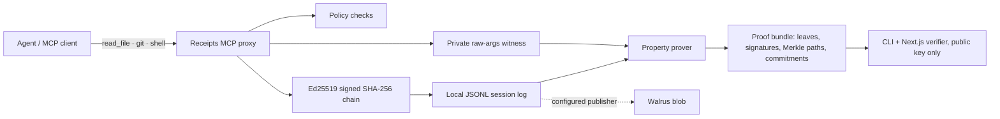

# Blackbox Receipts

**Proof over promises: signed, tamper-evident records of AI agent tool calls.**



## Setup

Requires Node.js 20+ and pnpm 10+. Clone the repo, then:

```sh
pnpm install
cp .env.example apps/web/.env.local
pnpm build
pnpm test
```

Start the local dashboard with `pnpm dev`. In a second terminal, start the MCP server with `pnpm --filter @blackbox/proxy start`. It exposes `read_file`, read-only `git` (`status`, `diff`, `log`, `show`), and workspace `shell` tools over stdio. Connect an MCP client to `packages/proxy/dist/server.js` (stdio) and use those tools. Receipts are stored in `.blackbox/session.jsonl`; the proxy creates a private Ed25519 key in `.blackbox/` on first run. The dashboard reads the same live store at `http://localhost:3000`.

The dashboard and proxy share the repo's `.blackbox/` store. For another workspace, run the proxy with that directory as its current working directory. Set `RECEIPTS_DIR` to choose a different local store. Keep `.blackbox/` private: the signing key grants the ability to sign records and must not be shared.

## Architecture

- `packages/receipts` defines canonical receipt hashing, Ed25519 signing, chain verification, Merkle roots and proofs, and the selective-disclosure property query (`proveProperty`, `verifyPropertyProof`, `discloseStep`, `verifyDisclosure`).
- `packages/proxy` exposes actual local file, Git (including `show_stat`), and shell operations over MCP. `call.js` is a one-shot MCP client to it for environments without MCP support, and `RECEIPTS_RESUME=1` lets separate processes extend one session. The proxy applies secret path/production target rules, and appends every successful or denied invocation to JSONL. Raw tool arguments go to a private `.blackbox/witness.jsonl`; receipts carry only their hash.
- `apps/web` is a responsive Next.js timeline and verifier. It polls the same local session and expands signed records. **Prove: no secrets read** runs the property query, and the tamper button alters a saved row to demonstrate detection.

## Prove a property: "the agent never read secrets"

The prover takes the session's receipt chain, the private witness and a policy. The default policy (`defaultSecretPolicy`) lists secret path globs (`.env*`, `*.pem`, `*.key`, `~/.ssh/**`, `~/.aws/**`, `secrets/**`, `.blackbox/**` and others) and secret-token patterns matched against every string argument, including shell commands (private key blocks, AWS, GitHub, GitLab, `sk-` and Slack tokens). It verifies the chain, checks each witness against the signed `argsHash`, evaluates every step, and then publishes a bundle containing, per step, only:

- the receipt leaf hash and the proxy's signature over it;
- a Merkle inclusion path from that leaf to the session root (its position must equal the step index);
- a salted property commitment binding the policy hash, step, leaf, `argsHash` and verdict.

The proxy key signs an attestation over the root and all commitments. A verifier needs only the bundle and the public key. Raw args, paths and results are never included. An auditor can be given one step's opening (`disclose <step>`) to check it against the proof without seeing any other step.

```sh
pnpm --filter @blackbox/proxy prove           # PASS writes .blackbox/proof-no-secrets.json; FAIL names the step
pnpm --filter @blackbox/proxy verify-proof    # or: node packages/proxy/dist/cli.js verify-proof <file> --public-key <pem> --root <hex>
node packages/proxy/dist/cli.js prove --policy my-policy.json
node packages/proxy/dist/cli.js disclose 3    # opening for one step only
node packages/proxy/dist/cli.js export       # receipts, public key, verdict and proof into receipts/<session>/
node packages/proxy/dist/cli.js verify-export # check every receipts/*/ export from its own files
pnpm verify                                   # chain integrity only
```

Outcomes: a clean chain gives `PASS no-secrets-read: N/N receipts …`. A tampered chain gives `FAIL … at step K: Chain verification failed: …`. An empty session gives `FAIL … No receipts exist`. A session that touched a secret gives `FAIL … at step K: read_file touched secret path matching ".env*"`. Denied attempts count as touching. The exit code is non-zero on any FAIL.

## Demo script (~2:30)

1. Open the dashboard and MCP client; make actual calls to `git` (`status`), `read_file` on a non-secret file, and `shell` (`pwd`). Point out the timeline filling from the shared JSONL session.
2. Select **Prove: no secrets read** and show the PASS card, then download the proof JSON. See `docs/demo-video-script.md` for the 2-minute video script.
3. Select **Run tamper demo**. The button edits the first stored receipt; the verifier identifies the broken step. Start a fresh session by removing the local `.blackbox/session.jsonl` while the app is stopped.
4. If `WALRUS_PUBLISHER_URL` is configured to a funded Walrus publisher, select the upload button and show its returned blob response. Otherwise, show the honest “not anchored” state.
5. Explain that a proxy signature proves what this process recorded; it does not prove a trusted execution environment or protect a compromised host.

Demo video: not recorded yet; add a share link here before submission.

## Sponsor technology

- Open Agent: usable as a local MCP server with any MCP-capable agent. Zetaris and Meterless client packages are included (see above). They have not been run against a live account, and they are not yet wired into the proxy.
- GitLab Transcend: `.gitlab/duo/flows/blackbox-receipts.yaml` is a Duo Agent Platform custom flow whose agent reads the repo only through the receipts bridge (`packages/proxy/dist/call.js`, a one-shot MCP client to the proxy). Runner-executed flows can't attach MCP servers, so the bridge is how each step still reaches the proxy over MCP. The flow exports `receipts/<session>/`, pushes it, and posts its answer with step-cited evidence and the verbatim PASS/FAIL verdict. `.gitlab-ci.yml` builds, tests, records a real proxy session and runs the verifier, and verifies any exported Duo session. `.gitlab/duo/mcp.json` registers the proxy for Duo in the IDE. Setup steps: [docs/gitlab-setup.md](docs/gitlab-setup.md). **Not yet run on GitLab**; don't claim a Duo run until one has happened.
- Walrus: the dashboard can upload the signed session payload to a configured publisher. No publisher endpoint or funding is bundled; it does not claim to have anchored when unavailable.

## Open Agent integrations: Zetaris and Meterless

Two workspace packages call each sponsor's real interface. Neither has mock responses: if configuration is missing, the constructor throws a `ZetarisConfigError` or `MeterlessConfigError` that names the missing variable. Neither is wired into the proxy or dashboard yet.

**`packages/zetaris` (`@blackbox/zetaris`)** is a client for the Zetaris SaaS REST API, written against its OpenAPI spec ([Redoc](https://api.saas.enterprise.zetaris.com/redoc/index.html), [how to access the API](https://kbase.zetaris.com/knowledge/accessing-zetaris-using-api)).

- Env vars: `ZETARIS_API_KEY` (from the Zetaris Console) and `ZETARIS_ORG_ID` (an integer from Zetaris Support/Admin) are required. `ZETARIS_BASE_URL` is optional and defaults to `https://api.saas.enterprise.zetaris.com`.
- Each call sends `Authorization: Bearer <api key>`, `X-Org-ID` and a fresh `X-Request-ID` UUID.
- Methods: `listDataMarts`, `listDataMartTables`, `listLightningDatabases`, `startSql`, `pageSql`, `closeSql`, and `querySql`, which follows every page and always closes the cursor. `login(username, password)` covers the Basic-auth JWT endpoint.

**`packages/meterless` (`@blackbox/meterless`)** is a client for the Meterless Runtime (the Nightshift hotspot). The runtime is an OpenAI-compatible provider that runs on your own machine, so Meterless has **no hosted API or `METERLESS_API_KEY`**. The client follows the [Meterless provider contract](https://github.com/meterless/meterless/blob/main/docs/agent-ready/add-meterless-provider.md) (Runtime 0.90.0).

- Token: set `METERLESS_TOKEN`, or set `METERLESS_STATE_DIR` and the client reads `<stateDir>/proxy-token`. The placeholder `rt-local` is rejected.
- `METERLESS_BASE_URL` defaults to `http://127.0.0.1:8088/v1`. Any pasted form of the URL is normalised to `<host>/v1`.
- Methods: `status()` returns `online`, `unauthorized` or `offline`, decided by `GET /v1/models` as the contract requires. `listModels()` returns the routing modes, such as `meterless/auto`. `chat(messages, model)` returns the reply text.
- Every request sends `meterless-app: blackbox-receipts`, chat requests also send `meterless-scope: user`, and requests time out after 180 s.

**Tests.** Run `pnpm test` (the files are `test/zetaris.test.ts` and `test/meterless.test.ts`).

- Config and URL tests always run.
- Live tests run only when the keys are set. Otherwise they are skipped and print a `⚠️ SKIPPING LIVE … TESTS` banner, so a green CI run never implies a live call happened.
- The Zetaris SQL test also needs `ZETARIS_TEST_SQL`, a `SELECT` against your org.

## Limitations

- Local single-session JSONL storage; no Postgres index, multi-tenant access control, or remote hosted proxy.
- Secret-path checks cover `.env*`, `secrets/`, `.blackbox/`, and common SSH key filenames. The shell tool accepts only direct `pwd`, `ls`, and `cat` calls. Git diff/show require explicit literal file paths. This is a demo policy guard, not an OS sandbox; use isolated workspaces and do not treat it as a security boundary.
- The property proof is selective disclosure with a trusted attester, not zero knowledge. The verifier checks signatures, inclusion and the proxy's attestation, but it cannot recompute the policy over hidden args. It trusts the proxy key for that, the same key that signed the receipts. A Noir circuit over the committed args would remove this trust.
- A verifier can't see the `previousHash` links, so chain order inside the proof rests on leaf positions in the Merkle tree plus the prover's chain check. The root isn't independently anchored on-chain in this MVP; pass `--root` to pin the expected root.
- Glob and token matching is heuristic. A secret reached through an unlisted path or an obfuscated argument won't match. Receipts recorded before the witness log existed can't be proven and fail with "Raw arguments … are missing".
- No TEE attestation.
- No live GitLab Duo run or Walrus upload has been verified; the respective account/endpoint setup is required.
- In the Duo flow, `run_command` can technically run any command. The prompt restricts workspace reads to the bridge, but a read that bypasses the bridge would leave no receipt. The flow's own git commands (commit and push of the export) are outside the chain by design.
- Exported sessions include the signed receipts (tool names, paths, hashes), but never the raw arguments or the signing key. Each runner session uses a fresh key unless `BLACKBOX_PUBLIC_KEY` and `RECEIPTS_SIGNING_KEY` pinning is set up (untested on GitLab).

MIT license.
