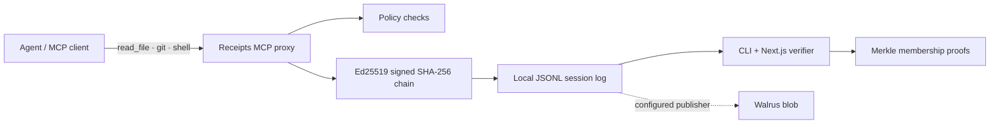

# Blackbox Receipts

**Proof over promises: signed, tamper-evident records of AI agent tool calls.**



## Setup

Requires Node.js 20+ and pnpm 10+. Clone the repo, then:

```sh
pnpm install
cp .env.example apps/web/.env.local
pnpm build
pnpm test
```

Start the local dashboard with `pnpm dev`. In a second terminal, start the MCP server with `pnpm --filter @blackbox/proxy start`. It exposes `read_file`, read-only `git` (`status`, `diff`, `log`, `show`), and workspace `shell` tools over stdio. Connect an MCP client to `packages/proxy/dist/server.js` (stdio) and use those tools. Receipts are stored in `.blackbox/session.jsonl`; the proxy creates a private Ed25519 key in `.blackbox/` on first run. The dashboard reads the same live store at `http://localhost:3000`.

The dashboard and proxy share the repo's `.blackbox/` store. For another workspace, run the proxy with that directory as its current working directory. Set `RECEIPTS_DIR` to choose a different local store. Keep `.blackbox/` private: the signing key grants the ability to sign records and must not be shared.

## Architecture

- `packages/receipts` defines canonical receipt hashing, Ed25519 signing, chain verification, Merkle roots and proofs, and the no-secrets property query.
- `packages/proxy` exposes actual local file, Git, and shell operations over MCP, applies secret path/production target rules, and appends every successful or denied invocation to JSONL.
- `apps/web` is a responsive Next.js timeline and verifier. It polls the same local session, expands signed records, proves the property, and can alter a saved row to demonstrate detection.
- `pnpm verify` checks `.blackbox/session.jsonl`; `pnpm --filter @blackbox/proxy prove-no-secrets` emits the membership paths.

## Demo script (~2:30)

1. Open the dashboard and MCP client; make actual calls to `git` (`status`), `read_file` on a non-secret file, and `shell` (`pwd`). Point out the timeline filling from the shared JSONL session.
2. Select **Verify session** and show the Ed25519 chain and Merkle proof paths for every receipt.
3. Select **Run tamper demo**. The button edits the first stored receipt; the verifier identifies the broken step. Start a fresh session by removing the local `.blackbox/session.jsonl` while the app is stopped.
4. If `WALRUS_PUBLISHER_URL` is configured to a funded Walrus publisher, select the upload button and show its returned blob response. Otherwise, show the honest “not anchored” state.
5. Explain that a proxy signature proves what this process recorded; it does not prove a trusted execution environment or protect a compromised host.

Demo video: not recorded yet; add a share link here before submission.

## Sponsor technology

- Open Agent: usable as a local MCP server with any MCP-capable agent; no sponsor-specific sign-up or API integration is included in this workspace.
- GitLab Transcend: GitLab Duo Agent Platform work is not yet connected to this proxy. A real Duo flow requires a GitLab project, Agent Platform entitlement, configured flow and a network-reachable MCP endpoint. Do not claim a Duo run until that is configured and exercised.
- Walrus: the dashboard can upload the signed session payload to a configured publisher. No publisher endpoint or funding is bundled; it does not claim to have anchored when unavailable.

## Limitations

- Local single-session JSONL storage; no Postgres index, multi-tenant access control, or remote hosted proxy.
- Secret-path checks cover `.env*`, `secrets/`, `.blackbox/`, and common SSH key filenames. The shell tool accepts only direct `pwd`, `ls`, and `cat` calls. Git diff/show require explicit literal file paths. This is a demo policy guard, not an OS sandbox; use isolated workspaces and do not treat it as a security boundary.
- The property is checked against the full list of proxy-signed records, with a Merkle membership proof for each leaf. The proof establishes membership under the computed root; the root is not independently on-chain anchored in this MVP.
- No TEE attestation or zero-knowledge selective disclosure.
- No live GitLab Duo run or Walrus upload has been verified; the respective account/endpoint setup is required.

MIT license.
