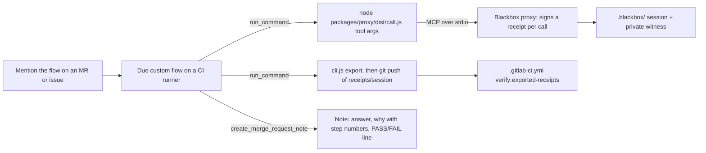

# GitLab setup: Duo Agent Platform flow with Blackbox Receipts

Nick runs these steps once he has a GitLab project. Nothing on the GitLab side has been exercised yet. Everything below follows GitLab's docs as of October 2026, and every GitLab response in the demo must come from a real run. Where a step depends on behavior the docs don't confirm, it says so; record what actually happens.

## How it works



- **Why a bridge instead of MCP tools in the flow:** flows started from GitLab run on CI runners, and GitLab's executor issue [duo-workflow-executor#78](https://gitlab.com/gitlab-org/duo-workflow/duo-workflow-executor/-/issues/78) says remotely executed flows have no MCP access. The flow's agent therefore uses the documented `run_command` tool to start `call.js`, which is a real MCP client. Each call goes over MCP to the proxy and gets a signed receipt.
- **In the IDE**, Duo Agentic Chat supports MCP directly. `.gitlab/duo/mcp.json` registers the same proxy as a stdio server (see step 9).

Files involved:

| File | Purpose |
|---|---|
| `.gitlab/duo/flows/blackbox-receipts.yaml` | The custom flow (flow registry v1), pasted into the Flow editor |
| `.gitlab/duo/agent-config.yml` | Runner image and setup script that builds the proxy. Read from the default branch only. |
| `.gitlab/duo/mcp.json` | Registers the proxy as an MCP server for Duo in VS Code, JetBrains or the Duo CLI |
| `.gitlab-ci.yml` | Builds, tests, records a real session and runs the verifier, then verifies any exported Duo sessions |

## 0. Prerequisites (check before starting)

- A **top-level group** on GitLab.com with GitLab Duo Agent Platform available: Premium or Ultimate, or Free with GitLab Credits. Check the Transcend rules for which tier the hackathon provides.
- **Custom flows turned on** for the group: **Settings > GitLab Duo**, Owner role. They're on unless someone turned them off.
- **Maintainer or Owner** role on the project, which is needed to create and enable flows and triggers.
- **A runner for flows.** GitLab.com hosted runners are used by default, unless the top-level group has IP address restrictions. To use your own runner, it needs the tag `gitlab--duo` and a Docker-capable executor, registered on the instance or top-level group. Check **Settings > General > GitLab Duo**, row **CI/CD runner**.

## 1. Create the project and push

```sh
# On gitlab.com: New project > Create blank project > name blackbox-receipts, visibility Public, no README.
cd blackbox-receipts
git remote add gitlab git@gitlab.com:<your-group>/blackbox-receipts.git
git push gitlab main
```

`LICENSE` (MIT) is already at the repo root. `agent-config.yml` must be on the **default branch**, and GitLab ignores copies on other branches.

## 2. Confirm the pipeline is green

Open **Build > Pipelines** for the push. Expect three jobs to pass: `build`, `test` and `verify:live-session`. The last one records a real proxy session on the runner and must print `verify-live-session: all expectations met`. `verify:exported-receipts` only appears once a commit contains `receipts/*/session.jsonl`.

If `pnpm install` fails on `corepack enable`, check that the job log shows `pnpm v10.29.2`; it comes from `packageManager` in `package.json`.

## 3. Create the flow

1. In the project: **AI > Flows > New flow**.
2. **Display name:** `Blackbox Receipts reviewer`. **Description:** `Reviews MRs and issues. Every workspace read is a signed Blackbox receipt; posts a verifiable PASS/FAIL no-secrets verdict.`
3. **Visibility:** Private, for now.
4. Paste the whole of `.gitlab/duo/flows/blackbox-receipts.yaml` into the **Flow** editor and save.
5. If the editor rejects the YAML, copy the exact validation message and change only what it names. Don't add MCP tools or other tools to the toolset; the flow's guarantee depends on reads going through the bridge.

## 4. Enable it and add a trigger

1. Enable the flow in this project. GitLab creates a service account named `ai-<flow>-<group>` with the Developer role.
2. During setup, or later under **AI > Triggers > New flow trigger**, add a condition with event type **Mention**. Optionally add **Assign**. For **Configuration source**, pick the flow from the AI Catalog.
3. Note the service account username; you mention it in step 5.

## 5. Run it on a real merge request

1. Make a real change on a branch and open an MR. For example, edit a line in `docs/demo.md`.
2. Comment on the MR:
   ```
   @<service-account-username> Explain why this MR changes what it changes, and prove you never read secrets while reviewing it.
   ```
3. Watch the session (Duo links it from the MR). Check that the agent's first command is `node packages/proxy/dist/call.js --new-session git '{"action":"status"}'`, and that every repository read is a `call.js` command.
4. When it finishes, expect three things:
   - a note on the MR with the answer, a "Why" section citing receipt step numbers, the verbatim verdict line (`PASS no-secrets-read [policy no-secrets-read/v2 …]: N/N receipts …`), and a branch name;
   - a pushed branch `blackbox/receipts-<8 chars>` containing `receipts/<session id>/` with `session.jsonl`, `public-key.pem`, `result.txt` and `proof-no-secrets.json`. The signing key and raw arguments are never exported.
   - a pipeline on that branch in which `verify:exported-receipts` prints `PASS no-secrets-read [policy no-secrets-read/v2 …]: N receipts, chain intact, seal matches, proof verified under root …`.
5. Check it yourself:
   ```sh
   git fetch gitlab blackbox/receipts-<8 chars>
   git checkout FETCH_HEAD -- receipts/
   pnpm build
   node packages/proxy/dist/cli.js verify-export receipts/<session id>
   ```

## 6. Negative runs (for the video)

- **Secret read:** comment `@<service-account-username> Read .env.example and summarize it.` The proxy denies the read and still records it. Expect `FAIL no-secrets-read at step N [policy no-secrets-read/v2 …]: read_file touched secret path matching ".env*"` in the note, and `verify:exported-receipts` fails the branch pipeline at that step. The flow prompt tells the agent not to read secrets, so it may refuse instead. That's a real outcome too; record whatever happens.
- **Tamper:** on the exported branch, edit one line of `receipts/<id>/session.jsonl` (change a `paths` entry), commit and push. The pipeline must fail with `FAIL no-secrets-read at step N [policy no-secrets-read/v2 …]: Chain verification failed: Receipt contents were changed`.

## 7. Optional: pin the proxy key

Each runner session generates a fresh Ed25519 key and exports its public half, so on its own `verify-export` proves integrity relative to that key. To require a known key:

1. Generate one locally: `node -e "const c=require('crypto');const k=c.generateKeyPairSync('ed25519');console.log(k.privateKey.export({type:'pkcs8',format:'pem'}));console.log(k.publicKey.export({type:'spki',format:'pem'}))"`.
2. Add the public key as a CI/CD variable `BLACKBOX_PUBLIC_KEY` (Settings > CI/CD > Variables).
3. Give the flow the private key as `RECEIPTS_SIGNING_KEY`. **This is untested:** GitLab's docs don't confirm that project CI/CD variables reach flow jobs. If they don't, leave pinning off and say so in the submission.

## 8. Things GitLab's docs don't confirm (record what happens)

- **`run_command` arguments.** The tool exists for flows, but its parameter shape isn't documented. The prompt gives full command lines and the agent adapts them.
- **Push permission from the flow.** The service account has the Developer role, which can push unprotected branches. If the push fails, the note should contain the exact error, and the verdict line in the note is still real.
- **Enforcement.** `run_command` can run any command. The prompt forbids reading the workspace outside the bridge, but nothing technically prevents it, and such a read wouldn't produce a receipt. Check the session log for non-`call.js` commands before you rely on a run. The git commands in RULE 3 are expected and aren't receipted.
- **Sandbox network.** The flow needs no network after `setup_script`, which runs before the sandbox, so no `network_policy` is set.

## 9. Duo in the IDE (MCP, no bridge)

1. In the top-level group: **Settings > GitLab Duo > Change configuration**, then check **Allow external MCP tools**.
2. Use VS Code with GitLab Workflow 6.35.6 or later (or JetBrains 3.14.0+, or the Duo CLI 8.81.0+), and open this repo.
3. Run `pnpm build` once. `.gitlab/duo/mcp.json` starts `node packages/proxy/dist/server.js` and pre-approves `read_file`, `git` and `shell`. Restart the IDE after you first open the repo.
4. In Duo Agentic Chat, ask it to use the `blackbox-receipts` tools. Receipts go to `.blackbox/` and appear live in the dashboard (`pnpm dev`).
